# CodeX User Manual

- [Getting Started](#getting-started)
  - [Accessing CodeX](#accessing-codex)
  - [Creating a Room](#creating-a-room)
  - [Joining a Room](#joining-a-room)
    - [Using a Room ID](#using-a-room-id)
    - [Using an Invite Link](#using-an-invite-link)
    - [Scanning QR Code](#scanning-qr-code)
  - [User Interface Overview](#user-interface-overview)
    - [Top Bar](#top-bar)
    - [Main Work Area (Split into Panels)](#main-work-area-split-into-panels)
    - [Bottom Panel](#bottom-panel)
    - [Status Bar](#status-bar)
- [Room Sharing](#room-sharing)
  - [Room ID](#room-id)
  - [Invite Link](#invite-link)
  - [QR Code](#qr-code)
- [Code Editor](#code-editor)
  - [Cursor](#cursor)
  - [Text Selection](#text-selection)
  - [Code Editor Settings](#code-editor-settings)
- [Follow Mode](#follow-mode)
  - [Enabling Follow Mode](#enabling-follow-mode)
  - [Limitations](#limitations)
- [Code Execution](#code-execution)
  - [Passing Arguments and Input (stdin)](#passing-arguments-and-input-stdin)
  - [Reading the Output](#reading-the-output)
- [Shared Terminal](#shared-terminal)
  - [Download Output](#download-output)
  - [Clear Output](#clear-output)
- [GitHub Integration](#github-integration)
  - [Authentication](#authentication)
  - [Disconnecting GitHub Account](#disconnecting-github-account)
  - [Opening Files from GitHub](#opening-files-from-github)
  - [Saving Files to GitHub](#saving-files-to-github)
- [Live Preview](#live-preview)
  - [Enabling/Disabling Live Preview](#enablingdisabling-live-preview)
  - [Limitations of Live Preview](#limitations-of-live-preview)
  - [Live Preview Example](#live-preview-example)
    - [Example 1: HTML with Tailwind CSS](#example-1-html-with-tailwind-css)
    - [Example 2: HTML with Alpine.js, GSAP, and Chart.js](#example-2-html-with-alpinejs-gsap-and-chartjs)
    - [Example 3: React with htm, Recharts, and canvas-confetti](#example-3-react-with-htm-recharts-and-canvas-confetti)
- [Notepad](#notepad)
  - [Notepad Features](#notepad-features)
  - [Markdown Support](#markdown-support)
  - [Limitations of Notepad](#limitations-of-notepad)
  - [Saving and Opening Notes](#saving-and-opening-notes)
    - [Saving Notes](#saving-notes)
    - [Opening Notes](#opening-notes)
- [Video \& Voice Communication](#video--voice-communication)
  - [Screen Sharing](#screen-sharing)
- [Troubleshooting](#troubleshooting)
  - [Follow Mode not working](#follow-mode-not-working)
  - [Code is not Syncing Between Users](#code-is-not-syncing-between-users)
  - [This language is not supported or the execution server is down](#this-language-is-not-supported-or-the-execution-server-is-down)
  - [Process timed out](#process-timed-out)
  - [Process stopped because its output was too long](#process-stopped-because-its-output-was-too-long)
  - [No code to execute](#no-code-to-execute)
  - [Error parsing markdown](#error-parsing-markdown)
  - [Please check the information and try again](#please-check-the-information-and-try-again)
  - [Failed to import settings. Please check the file format](#failed-to-import-settings-please-check-the-file-format)
  - [Parsing of the Following Markdown Structure Failed](#parsing-of-the-following-markdown-structure-failed)
  - [Error accessing camera or microphone](#error-accessing-camera-or-microphone)
  - [Please grant `media-device` permissions to see available devices](#please-grant-media-device-permissions-to-see-available-devices)
  - [Error enumerating devices](#error-enumerating-devices)
  - [Error sharing screen](#error-sharing-screen)
  - [Connecting video… or Reconnecting video…](#connecting-video-or-reconnecting-video)
  - [Video calls aren't set up on this server](#video-calls-arent-set-up-on-this-server)
  - [Performance Tips](#performance-tips)
- [Security Considerations](#security-considerations)
- [Privacy and Security](#privacy-and-security)
  - [Data Handling](#data-handling)
  - [User Privacy](#user-privacy)
  - [GitHub Access Permissions](#github-access-permissions)
- [Appendix](#appendix)
  - [Supported Editor Languages](#supported-editor-languages)
  - [Supported Execution Languages](#supported-execution-languages)
  - [Keyboard Shortcuts in Menu Bar](#keyboard-shortcuts-in-menu-bar)
    - [File](#file)
    - [Edit](#edit)
    - [Selection](#selection)
    - [View](#view)
    - [Go](#go)
    - [Code](#code)
  - [Pre-Installed Libraries for Live Preview](#pre-installed-libraries-for-live-preview)
  - [Notepad Features and Markdown Syntax](#notepad-features-and-markdown-syntax)

## Getting Started

### Accessing CodeX

CodeX is a web-based application that requires no installation. To access CodeX:

1. Open your web browser
2. Navigate to [https://codex.dulapahv.dev/](https://codex.dulapahv.dev/).
3. The platform will load automatically in your browser

### Creating a Room

To create a new coding session:

1. On the homepage, locate the `Create a Room` section
2. Enter your preferred display name in the `Name` field
3. Click `+ Create Room` to start a new session
4. You'll be automatically redirected to your coding room

<div align="center">
  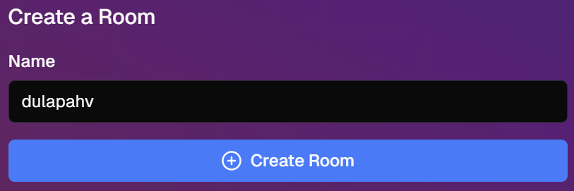
</div>

### Joining a Room

A valid room ID must be in a `XXXX-XXXX` format where `X` is an alphanumeric character.

There are three ways to join an existing room:

#### Using a Room ID

1. On the homepage, find the `Join a Room` section
2. Input the room ID provided by the room creator in the `Room ID` field.
   > When inputting the room ID, no need to include the hyphen `-` as it will be added automatically.
3. Enter your display name in the `Name` field
4. Click `Join Room →`

<div align="center">
  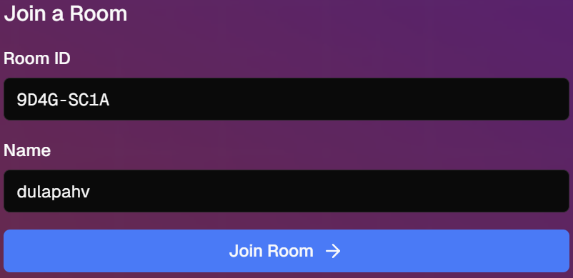
</div>

#### Using an Invite Link

1. Click the invite link shared with you
2. Enter your display name in the `Name` field when prompted
3. Click `Join Room →`

<div align="center">
  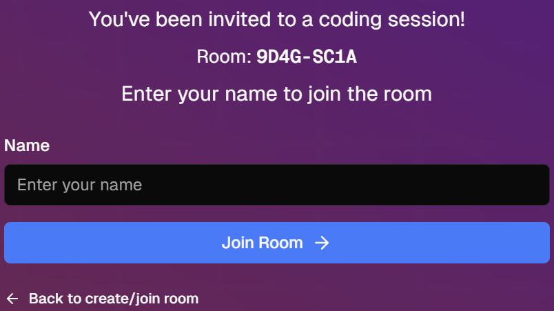
</div>

#### Scanning QR Code

1. Use your mobile device to scan the QR code shared by the room creator
2. Enter your display name in the `Name` field when prompted
3. Click `Join Room →`

<div align="center">
  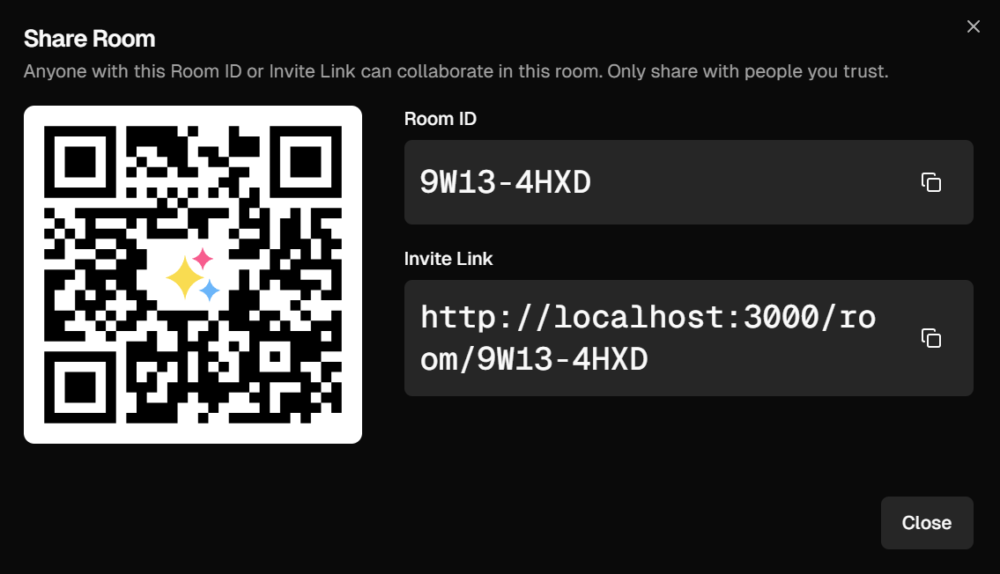
</div>

### User Interface Overview

Once you enter a room, you'll see several key interface elements.
The interface is divided into several sections, each section contains multiple panels.

- Panels can be resized by dragging the dividers
- Panels can be hidden/shown using toolbar buttons (`view > panel name`)

<div align="center">
  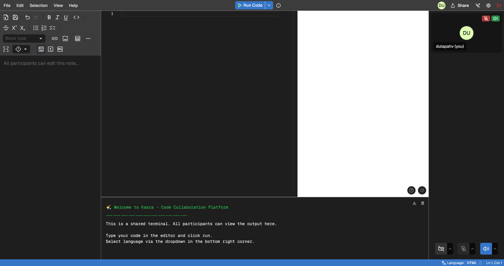
</div>

#### Top Bar

<div align="center">
  
</div>

1. **Menu Bar**
   - Contains File, Edit, Selection, View, Go, Code, and Help menus
2. **Run Code Button**
   - Execute your code directly from the editor
   - For list of supported execution languages, refer to the [Supported Execution Languages](#supported-execution-languages) section
3. **User List**
   - Displays the list of users in the room
4. **Share Button**
   - Share your room with others via a link or QR code
5. **Follow User**
   - Opens a dropdown to follow another user's actions
6. **Settings**
   - Connect to GitHub, and adjust editor settings

#### Main Work Area (Split into Panels)

<div align="center">
  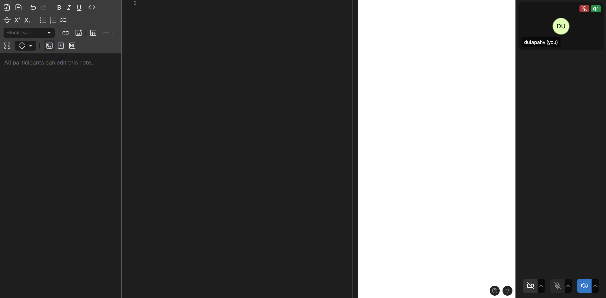
</div>

1. **Left Most Panel - Notepad**

   - Rich text formatting toolbar (Bold, Italic, Underline, etc.)
   - Block type selector for different content types
   - Collaborative note-taking area
   - Table and media insertion tools

2. **Center Left Panel - Code Editor**

   - Main coding area with syntax highlighting
   - Line numbers
   - Real-time collaboration
   - Multi-cursor support

3. **Right Right Panel - Live Preview**
   - Live preview of code output
   - UI rendering for web development
   - Real-time updates

4. **Right Most Panel - Video & Voice Communication**
   - Video and voice communication controls
   - Toggle camera, microphone, and audio settings
   - See and hear other participants

#### Bottom Panel

<div align="center">
  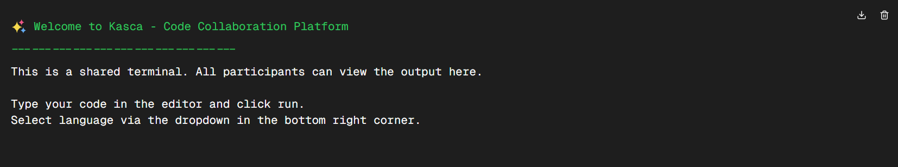
</div>

1. **Terminal**

- Shared terminal with welcome message
- Command output display
- Download and clear outputs options
- Color-coded text output

#### Status Bar

<div align="center">
  
</div>

1. **Language Selector:**
   - Shows current programming language (e.g., "HTML")
   - For list of supported editor languages, refer to the [Supported Editor Languages](#supported-editor-languages) section
2. **Line and Column Indicator:**
   - Shows cursor position in the editor

## Room Sharing

CodeX allows you to share your room with others using multiple methods:

<div align="center">
  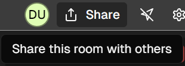
</div>

<div align="center">
  
</div>

### Room ID

1. Click the `Share` button in the top bar
2. Copy the room ID from the `Room ID` field

### Invite Link

1. Click the `Share` button in the top bar
2. Click the `Copy Invite Link` button

### QR Code

1. Click the `Share` button in the top bar

## Code Editor

The Monaco Editor forms the core of CodeX's collaborative coding environment, enabling multiple users to code together in real-time. Key features include:

- Real-time synchronization of code changes across all participants
- Multi-cursor support showing everyone's positions
- Syntax highlighting for over 90 programming languages (For a list of supported editor languages, refer to the [Supported Editor Languages](#supported-editor-languages) section)
- Intellisense for code completion
- Error detection and linting
- You can configure, import and export editor settings to customize your coding environment. Learn more in the [Code Editor Settings](#code-editor-settings) section
- The editor supports multiple shortcuts for common actions. Refer to the [Keyboard Shortcuts in Menu Bar](#keyboard-shortcuts-in-menu-bar) section for a list of supported shortcuts

### Cursor

Each participant's cursor is displayed with a unique color. The color is generated from user name and is consistent across all participants

- Cursor labels show usernames and colors
- Cursor positions are updated in real-time as users type or move
- Cursor labels appear above the text by default, and appear below when at the first line of the editor

<div align="center">
  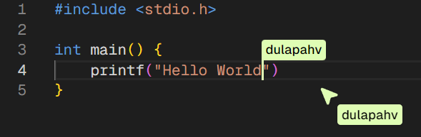
</div>

### Text Selection

- Active selections are highlighted for all participants
- Selection highlights appear in both the main editor and minimap
- Multiple concurrent selections from different users are supported
- Selection information (character count) is displayed in the lower right corner of the status bar

<div align="center">
  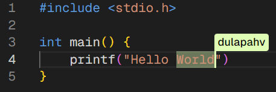
</div>

### Code Editor Settings

You can configure the code editor as well as its theme to suit your preferences by going to `Settings` in the upper right corner of the top bar.

<div align="center">
  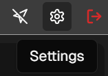
</div>

- To import settings, click on the `Import Settings` button and upload a JSON file
- To export settings, click on the `Export Settings` button to download a JSON file

The settings are persisted across sessions and are stored in your browser's local storage.

<div align="center">
  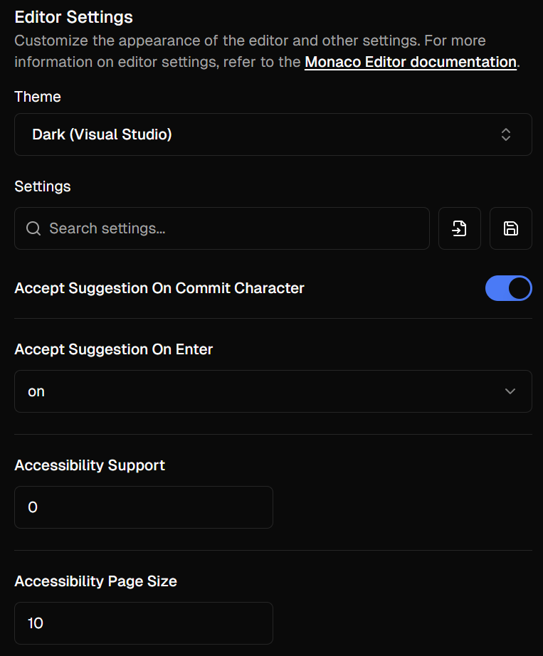
</div>

## Follow Mode

Follow Mode allows users to track another participant's actions in real-time by syncing their view with the followed user's view.

### Enabling Follow Mode

1. Click on the Follow User button in the upper right corner of the top bar

    <div align="center">
      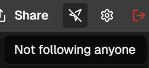
    </div>

2. Select or search for the user you want to follow

    <div align="center">
      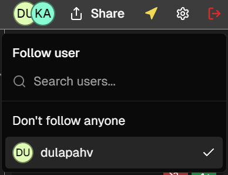
    </div>

3. Your editor view will now sync with the selected user's actions

### Limitations

- You cannot follow a user who is already following you
- You cannot follow a user who is already following another user

## Code Execution

<div align="center">
  
</div>

You can execute code directly from the editor using the `Run Code` button in the top bar. The output will be displayed in the [Shared Terminal](#shared-terminal).

For a list of supported execution languages, refer to the [Supported Execution Languages](#supported-execution-languages) section.

### Passing Arguments and Input (stdin)

You can pass arguments to your code by:

<div align="center">
  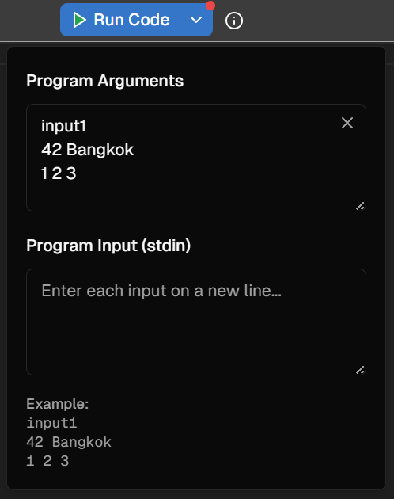
</div>

1. Click on the arrow down icon next to the `Run Code` button
2. Enter your arguments or input in the text area

Arguments and Input must be separated by a newline. For example:

```txt
input1
42 Bangkok
1 2 3
```

Empty lines are ignored. You can also use `'` and `"` in your arguments and input.

### Reading the Output

Each result in the [Shared Terminal](#shared-terminal) starts with the language, its version, and how long the run took, for example `Python v3.10.0 (ran in 43ms using 7.6 MB)`.

- `compiled in` appears for compiled languages such as C, C++, and Rust
- `ran in` is how long your program itself ran, and `using` is the most memory it used

If your program doesn't finish normally, the last line says why:

| Message                                                 | Meaning                                                                          |
| ------------------------------------------------------- | -------------------------------------------------------------------------------- |
| `Process exited with code <n>`                          | Your program exited with a non-zero code, usually because of an error            |
| `Compilation failed with code <n>`                      | Your code didn't compile, so it never ran. The compiler's errors are shown above |
| `Process timed out` or `Compilation timed out`          | It ran longer than the execution server allows                                   |
| `Process stopped because its output was too long`       | Your program printed more than the execution server allows                       |
| `Process stopped because its error output was too long` | Your program printed more errors than the execution server allows                |
| `Process was killed by <signal>`                        | Your program crashed, for example `SIGSEGV` for a segmentation fault             |

## Shared Terminal

The Shared Terminal allows you to execute commands and view the output in real-time. The terminal is shared among all participants in the room, and anyone who joins later sees the room's 50 most recent results.

At the upper right corner of the terminal panel, you can [Download Output](#download-output) or [Clear Output](#clear-output).

<div align="center">
  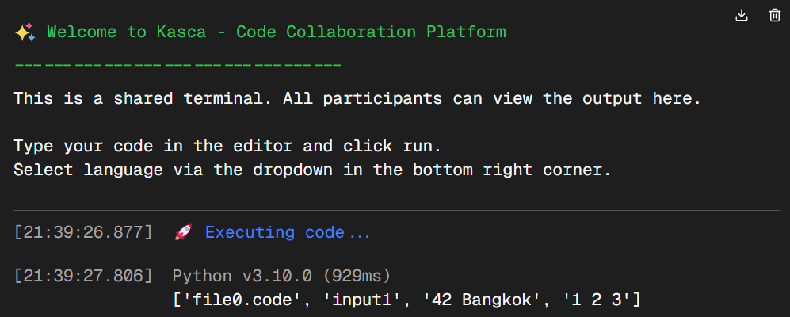
</div>

### Download Output

File name will be `codex-terminal-<date>--<time>.txt`, for example `codex-terminal-06-01-2025--17-37-28.txt`

- Terminal output will not contain CodeX welcome message
- Example output file:

    ```txt
    [18:35:33.060]
    🚀 Executing code...

    [18:35:33.760] - python v3.10.0 (ran in 43ms using 7.6 MB)
    Hello World
    ```

### Clear Output

- Clear the terminal output on your screen only. Other participants keep theirs, and the room's saved output is unchanged, so it comes back if you rejoin.

## GitHub Integration

CodeX allows you to connect your GitHub account to open and save files directly from your repositories.

### Authentication

CodeX requires `repo` access scope to read and write to your repositories. For more information, refer to the [GitHub Access Permissions](#github-access-permissions) section.

To connect your GitHub account:

<div align="center">
  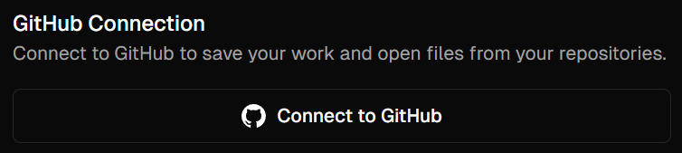
</div>

1. Click on the `Settings` button in the top bar
2. Click on the `Connect to GitHub` button
3. Follow the prompts to authenticate your GitHub account
4. Once connected, you can open and save files from your GitHub repositories

### Disconnecting GitHub Account

To disconnect your GitHub account:

<div align="center">
  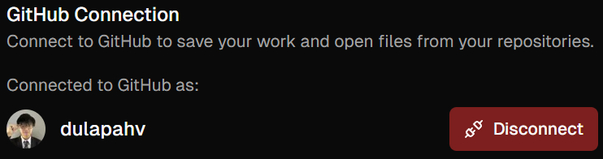
</div>

1. Click on the `Settings` button in the top bar
2. Click on the `Disconnect` button

### Opening Files from GitHub

1. Click on the `File` menu in the top bar

    <div align="center">
      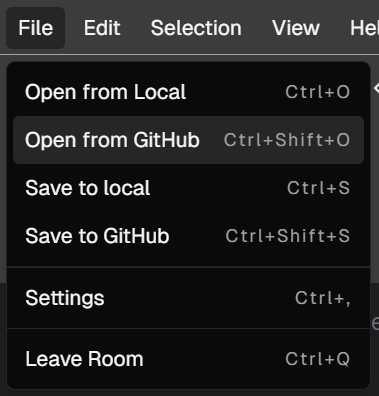
    </div>

2. Click on `Open from GitHub`
   - If you are not connected to GitHub, you will be prompted to connect your account
   - If the current code editor is not empty, a confirmation dialog will appear asking if you want to replace the current code with the file from GitHub
      <div align="center">
        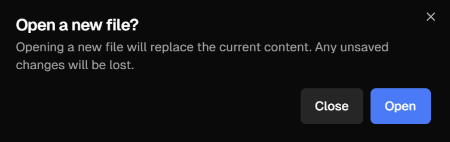
      </div>
3. Select the repository, branch, and file you want to open
4. The file will be loaded into the editor

<div align="center">
  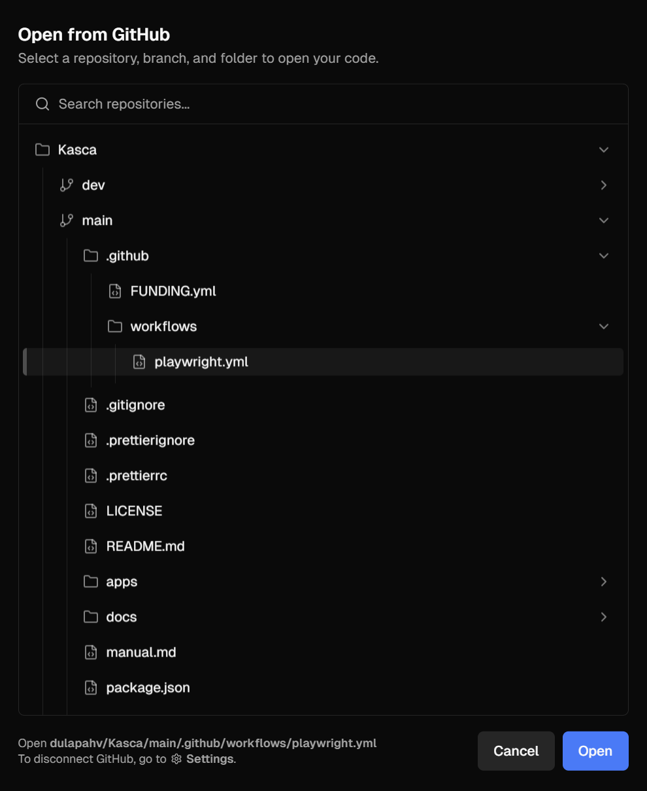
</div>

CodeX will automatically detect the language of the file and switch the editor's language mode accordingly. Other users' editors will also automatically switch to the same language mode.

### Saving Files to GitHub

1. Click on the `File` menu in the top bar

<div align="center">
  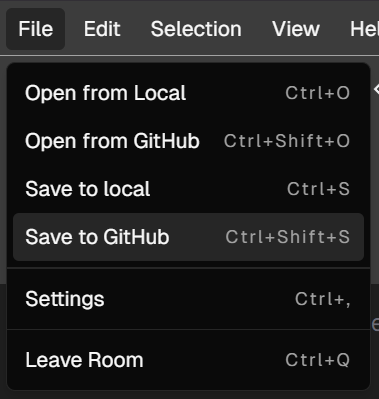
</div>

2. Click on `Save to GitHub`
    - If you are not connected to GitHub, you will be prompted to connect your account
3. Enter the file name and commit message
4. Click `Save`

<div align="center">
  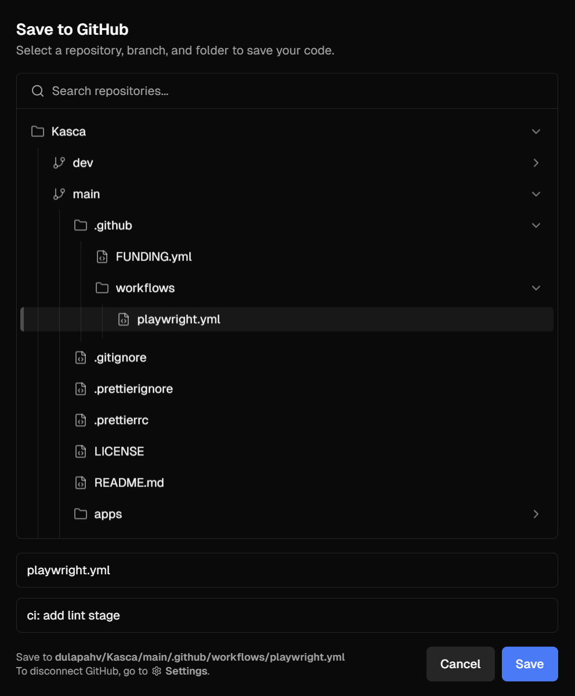
</div>

Upon saving, an alert will appear at the bottom right corner of the screen indicating the success or failure of the save operation. From there, you can click on the link to view the commit on GitHub.

<div align="center">
  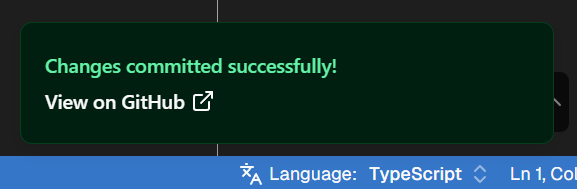
</div>

## Live Preview

The Live Preview panel allows you to see real-time updates of your code output. It is particularly useful for web development to see how your code renders in a browser.

<div align="center">
  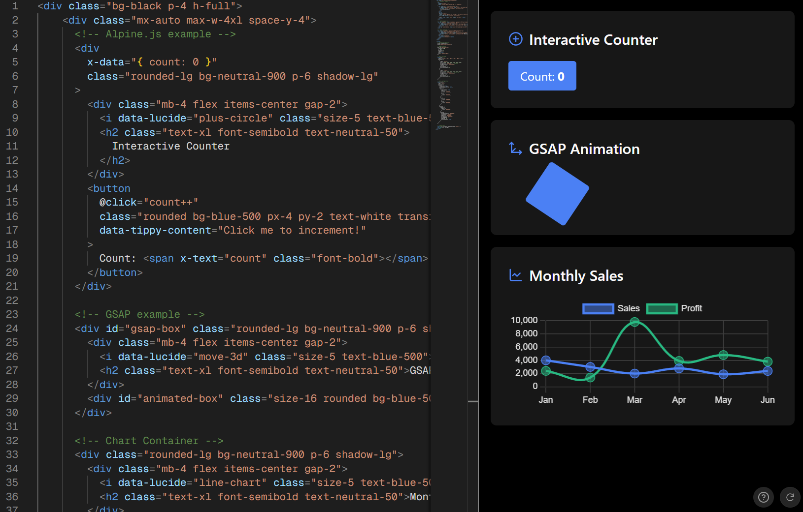
</div>

- Tailwind CSS utility classes are available
- Pre-installed libraries load automatically when your code mentions them, such as `gsap` or `x-data`
- Add custom styles with `<style>` tags
- Add custom scripts with `<script>` tags
- Add external libraries in `<head>` tags

For a list of pre-installed libraries and what loads each one, refer to the [Pre-Installed Libraries for Live Preview](#pre-installed-libraries-for-live-preview) section.

### Enabling/Disabling Live Preview

1. Click on the `View` menu in the top bar
2. Click on `Live Preview`

<div align="center">
  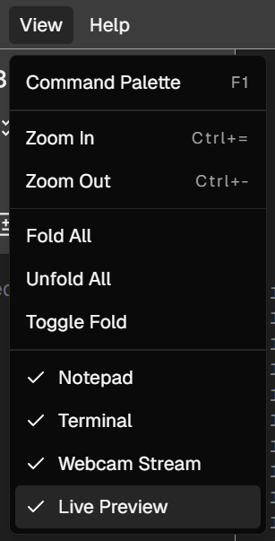
</div>

### Limitations of Live Preview

- Only HTML code is supported
- External libraries you add yourself are downloaded again on every update because the preview runs in an isolated sandbox, while pre-installed libraries are downloaded once per session
- React is loaded as v18 because React 19 no longer ships a build that works in a `<script>` tag. JSX needs a build step, so use [htm](https://github.com/developit/htm) or `React.createElement` instead (see [Example 3](#example-3-react-with-htm-recharts-and-canvas-confetti))

### Live Preview Example

#### Example 1: HTML with Tailwind CSS

```html
<style>
  .test {
    background-color: blue;
  }
</style>

<p class="test text-5xl text-white font-bold">
  Hello World
</p>
```

<div align="center">
  
</div>

#### Example 2: HTML with Alpine.js, GSAP, and Chart.js

```html
<div class="bg-black p-4 h-full">
  <div class="mx-auto max-w-4xl space-y-4">
    <!-- Alpine.js example -->
    <div
      x-data="{ count: 0 }"
      class="rounded-lg bg-neutral-900 p-6 shadow-lg"
    >
      <div class="mb-4 flex items-center gap-2">
        <i data-lucide="plus-circle" class="size-5 text-blue-500"></i>
        <h2 class="text-xl font-semibold text-neutral-50">
          Interactive Counter
        </h2>
      </div>
      <button
        @click="count++"
        class="rounded bg-blue-500 px-4 py-2 text-white transition-colors hover:bg-blue-600"
        data-tippy-content="Click me to increment!"
      >
        Count: <span x-text="count" class="font-bold"></span>
      </button>
    </div>

    <!-- GSAP example -->
    <div id="gsap-box" class="rounded-lg bg-neutral-900 p-6 shadow-lg">
      <div class="mb-4 flex items-center gap-2">
        <i data-lucide="move-3d" class="size-5 text-blue-500"></i>
        <h2 class="text-xl font-semibold text-neutral-50">GSAP Animation</h2>
      </div>
      <div id="animated-box" class="size-16 rounded bg-blue-500"></div>
    </div>

    <!-- Chart Container -->
    <div class="rounded-lg bg-neutral-900 p-6 shadow-lg">
      <div class="mb-4 flex items-center gap-2">
        <i data-lucide="line-chart" class="size-5 text-blue-500"></i>
        <h2 class="text-xl font-semibold text-neutral-50">Monthly Sales</h2>
      </div>
      <div class="relative">
        <canvas id="myChart"></canvas>
      </div>
    </div>
  </div>

  <script>
    // Initialize libraries
    lucide.createIcons();
    tippy('[data-tippy-content]');

    // GSAP animation
    gsap.to('#animated-box', {
      rotation: 360,
      x: 100,
      duration: 2,
      repeat: -1,
      yoyo: true,
      ease: 'power1.inOut',
    });

    // Chart.js setup
    const data = {
      labels: ['Jan', 'Feb', 'Mar', 'Apr', 'May', 'Jun'],
      datasets: [
        {
          label: 'Sales',
          data: [4000, 3000, 2000, 2780, 1890, 2390],
          borderColor: '#3b82f6', // blue-500
          backgroundColor: '#3b82f680',
          tension: 0.4,
          pointRadius: 6,
          pointHoverRadius: 8,
        },
        {
          label: 'Profit',
          data: [2400, 1398, 9800, 3908, 4800, 3800],
          borderColor: '#10b981', // emerald-500
          backgroundColor: '#10b98180',
          tension: 0.4,
          pointRadius: 6,
          pointHoverRadius: 8,
        },
      ],
    };

    // Chart configuration
    const config = {
      type: 'line',
      data: data,
      options: {
        responsive: true,
        maintainAspectRatio: false,
        scales: {
          y: {
            beginAtZero: true,
            grid: {
              color: '#404040',
            },
            ticks: {
              color: '#e5e5e5',
            },
          },
          x: {
            grid: {
              color: '#404040',
            },
            ticks: {
              color: '#e5e5e5',
            },
          },
        },
        plugins: {
          legend: {
            labels: {
              color: '#e5e5e5',
            },
          },
          tooltip: {
            backgroundColor: '#262626',
            titleColor: '#e5e5e5',
            bodyColor: '#e5e5e5',
            borderColor: '#525252',
            borderWidth: 1,
            padding: 10,
            displayColors: true,
          },
        },
      },
    };

    // Create chart
    const ctx = document.getElementById('myChart');
    new Chart(ctx, config);
  </script>
</div>
```

<div align="center">
  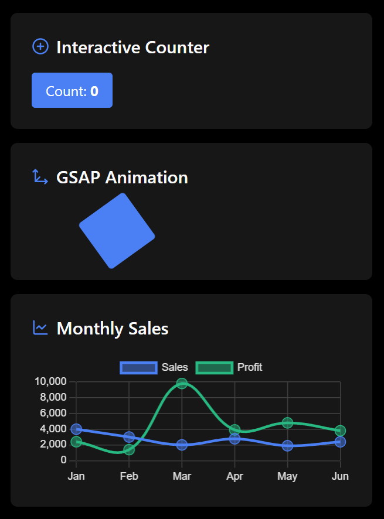
</div>

#### Example 3: React with htm, Recharts, and canvas-confetti

```html
<div id="root" class="p-4"></div>

<script>
  // htm gives React a JSX-like syntax without a build step
  const html = htm.bind(React.createElement);
  const { ResponsiveContainer, LineChart, Line, XAxis, YAxis, Tooltip } =
    Recharts;

  const data = [
    { month: 'Jan', sales: 4000 },
    { month: 'Feb', sales: 3000 },
    { month: 'Mar', sales: 5000 },
    { month: 'Apr', sales: 4780 },
    { month: 'May', sales: 5890 },
  ];

  const App = () => {
    const [count, setCount] = React.useState(0);

    const celebrate = () => {
      setCount(count + 1);
      confetti({ particleCount: 100, spread: 70 });
    };

    return html`
      <div className="space-y-4">
        <button
          className="rounded bg-blue-500 px-4 py-2 text-white hover:bg-blue-600"
          onClick=${celebrate}
        >
          Celebrate (${count})
        </button>
        <div className="h-64">
          <${ResponsiveContainer} width="100%" height="100%">
            <${LineChart} data=${data}>
              <${XAxis} dataKey="month" />
              <${YAxis} />
              <${Tooltip} />
              <${Line} type="monotone" dataKey="sales" stroke="#3b82f6" />
            <//>
          <//>
        </div>
      </div>
    `;
  };

  ReactDOM.createRoot(document.getElementById('root')).render(html`<${App} />`);
</script>
```

## Notepad

The Notepad panel allows you to take notes in a rich text format. It supports markdown syntax for text formatting and organization.

<div align="center">
  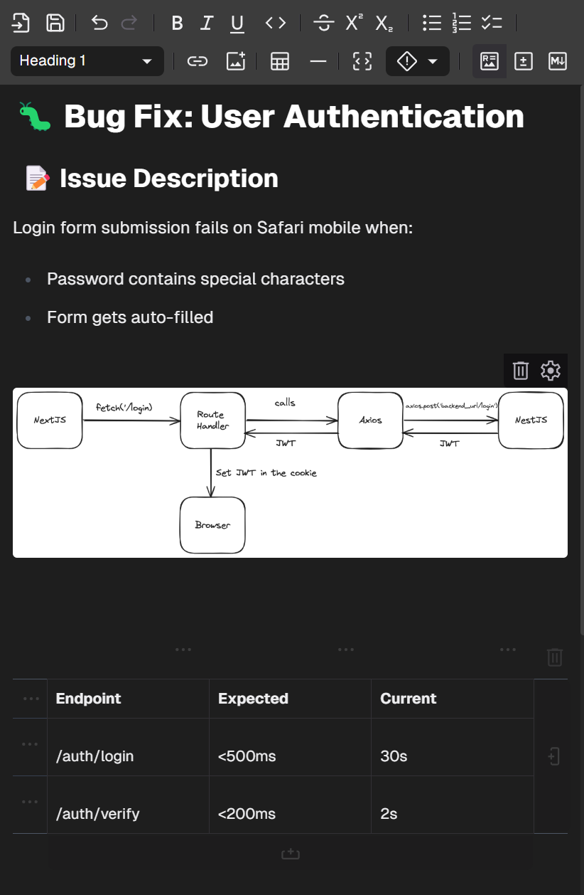
</div>

### Notepad Features

For a list of supported notepad features, markdown syntax, and shortcuts, refer to the [Notepad Features and Markdown Syntax](#notepad-features-and-markdown-syntax) section.

### Markdown Support

You can switch between `rich text` and `source` modes in the Notepad to view and edit markdown syntax.

<div align="center">
  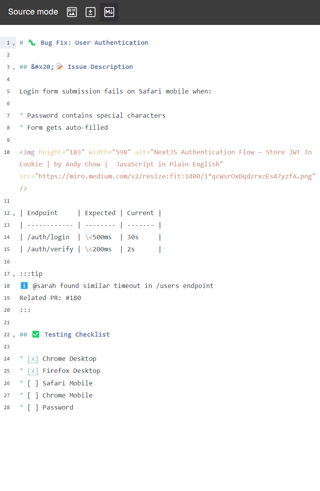
</div>

In case of an error parsing markdown, you can switch to `source` mode to fix the error. Refer to the [Error parsing markdown](#error-parsing-markdown) section.

### Limitations of Notepad

Notepad, unlike the code editor, is not optimized for real-time updates and may be slow on low-end devices when handling large amounts of text.

### Saving and Opening Notes

You can save notes to your local device or open existing notes in the Notepad.

<div align="center">
  
</div>

#### Saving Notes

1. Click on the `Save note` button in the Notepad
2. Enter the note name and click `Save`

Notes are saved in markdown format with the `.md` extension.

#### Opening Notes

1. Click on the `Open note` button in the Notepad
2. Select the note you want to open

For a list of supported file formats, refer to the [Notepad Features](#notepad-features) section.

## Video & Voice Communication

CodeX supports video and voice communication between participants in a room. You can toggle your camera, microphone, and audio settings in the Video & Voice Communication panel.

Video and audio travel through Cloudflare's network, so each person sends their camera once however many people are in the room, and calls work on networks that block direct connections. Nothing is recorded.

Your browser asks for permission the first time you turn on your camera or microphone.

<div align="center">
  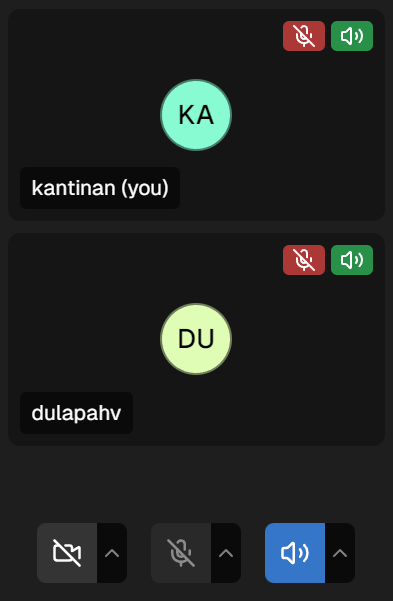
</div>

- To turn on camera, microphone, or audio, simply click on the respective buttons in the Video & Voice Communication panel.
- To change devices, click on the dropdown menu next to the respective button and select the desired device. CodeX switches straight away and remembers your choice.
- Turning off audio mutes everyone else for you only.

For troubleshooting video and audio issues, refer to the [Troubleshooting](#troubleshooting) section.

### Screen Sharing

Click the `Share screen` button in the Video & Voice Communication panel, then choose a screen, window or tab in your browser's picker. Screen sharing is available in desktop browsers only.

- Everyone else sees your screen in a `<your name>'s screen` tab in the Live Preview panel. The tab opens automatically, and the panel reappears if it was hidden.
- Use the button in the corner of a shared screen to view it full screen.
- You see `You're sharing your screen` in your own tab instead of a copy of your screen. Click `Stop sharing` there, click the `Stop sharing screen` button in the Video & Voice Communication panel, or use your browser's own stop button.
- Several people can share at once; each share has its own tab.
- Only the picture is shared, not your computer's sound.

## Troubleshooting

### Follow Mode not working

**This issue can be caused by:**

- Following a user who is already following you
- Following a user who is already following another user
- Network connectivity problems

**To resolve this issue:**

- Stop following the user
- Ask the user to stop following you
- Re-enable Follow Mode

### Code is not Syncing Between Users

**This issue can be caused by:**

- Network connectivity problems

CodeX reconnects automatically when the connection drops and catches up on any edits made in the meantime.

**To resolve this issue:**

1. Save your work, either by saving to local or GitHub
2. Refresh the page and rejoin the room with the same Room ID. The room keeps the code and notes that reached the server.
3. If it still doesn't sync, leave the room and create a new room

### This language is not supported or the execution server is down

**This issue can be caused by:**

- The selected language is not supported for execution
- The execution server is down

**To resolve this issue:**

- Check the list of [supported execution languages](#supported-execution-languages)
- Wait for the [execution server](https://github.com/engineer-man/piston) to come back online

### Process timed out

**This issue can be caused by:**

- An infinite loop
- A program that does too much work or sleeps for too long

**To resolve this issue:**

- Check that every loop in your code ends
- Run your program on a smaller input

### Process stopped because its output was too long

**This issue can be caused by:**

- A program that prints more than the execution server allows, often from a loop that prints on every pass

**To resolve this issue:**

- Print less, for example only the final result or a summary

### No code to execute

**This issue can be caused by:**

- No code in the editor

**To resolve this issue:**

- Write code in the editor

### Error parsing markdown

**This issue can be caused by:**

- Incorrect markdown syntax
- Incorrect markdown commands

**To resolve this issue:**

1. Switch to `source` mode in the Notepad
2. Correct the markdown syntax or commands
3. Switch back to `rich text` mode to see if the error disappears

### Please check the information and try again

**This issue can be caused by:**

- Not filling in the required fields
- Fields containing incorrect information
  - Name must not be empty and must not exceed 64 characters
  - Room ID must be in `XXXX-XXXX` format where `X` is an alphanumeric character

**To resolve this issue:**

- Check the information entered in the fields
- Correct any errors

### Failed to import settings. Please check the file format

**This issue can be caused by:**

- Trying to import settings from an unsupported file format
- Settings file is not a valid JSON file or is corrupted

**To resolve this issue:**

- Check the file format and ensure it is a valid JSON file

### Parsing of the Following Markdown Structure Failed

**This issue can be caused by:**

- Incorrect markdown syntax
- Incorrect markdown commands

**To resolve this issue:**

1. Switch to `source` mode in the Notepad
2. Correct the markdown syntax or commands
3. Switch back to `rich text` mode to see if the error disappears

### Error accessing camera or microphone

**This issue can be caused by:**

- Browser permissions are not granted
- Another app is using the camera or microphone
- No camera or microphone is connected

**To resolve this issue:**

- Grant the browser permissions to access media devices (camera, microphone, audio)
- Close other apps that use the camera or microphone, then try again
- Choose another device from the dropdown menu next to the button

### Please grant `media-device` permissions to see available devices

**This issue can be caused by:**

- Browser permissions are not granted

**To resolve this issue:**

- Grant the browser permissions to access media devices (camera, microphone, audio)

### Error enumerating devices

**This issue can be caused by:**

- Browser permissions are not granted

**To resolve this issue:**

- Grant the browser permissions to access media devices (camera, microphone, audio)

### Error sharing screen

**This issue can be caused by:**

- The browser isn't allowed to record the screen. On macOS, this is set in `System Settings > Privacy & Security > Screen & System Audio Recording`

**To resolve this issue:**

- Allow your browser to record the screen, restart the browser, then share again

Cancelling the browser's picker doesn't show an error; nothing is shared.

### Connecting video… or Reconnecting video…

**This issue can be caused by:**

- Network connectivity problems
- A network that blocks Cloudflare's video service

**To resolve this issue:**

1. Wait a few seconds; CodeX keeps retrying
2. Check your network connection, or try another network
3. Leave the room and refresh the page then rejoin the room

### Video calls aren't set up on this server

This appears in place of the video controls when the server CodeX connects to has no video service configured, for example a copy of CodeX running locally. Everything else in the room works as usual.

### Performance Tips

Live Preview is a heavy feature that may impact performance on low-end devices as it requires constant updates. To improve performance:

- Close the Live Preview panel when not in use by going to `View > Live Preview` in the top menu bar

The Notepad may also be slow on low-end devices when handling large amounts of text as it is not optimized for real-time updates. To improve performance:

- Avoid having multiple users editing the same note simultaneously
- Limit the amount of text in a single note

## Security Considerations

Live Preview and Code Execution will run code in a sandboxed environment to prevent malicious code execution. However, it is recommended to avoid running untrusted code and pasting sensitive information into the editor.

## Privacy and Security

### Data Handling

CodeX does not store any user data on the server except for:

- Display names
- User IDs
- Room IDs
- Code and the selected language
- Notes
- Terminal output (the 50 most recent results)

Video, audio and shared screens pass through Cloudflare's servers during a call and are never recorded or stored.

Display names and user IDs are kept only while you are connected. The room's code, notes and terminal output are saved with the room, so they survive server restarts, and are deleted with it. When all users leave the room, a 5-minute grace period begins. If someone rejoins within that time, the room and all its data are preserved. If no one rejoins, the room and its data are permanently deleted. Users can also choose to **Terminate Room** from the leave dialog to immediately delete the room and all its data without waiting for the grace period.

### User Privacy

When using CodeX, your data is encrypted in transit using HTTPS and stored securely on the server. However, it is recommended to avoid sharing sensitive information on the platform.

CodeX uses [Sentry](https://sentry.io) for error tracking to help identify and fix issues quickly. No personal data is collected or stored. The [Sentry's Session Replay](https://docs.sentry.io/product/explore/session-replay/) feature is enabled for faster debugging, and **all user inputs are masked** to prevent data exposure. Learn more about [how Session Replay captures data while protecting user privacy](https://docs.sentry.io/security-legal-pii/scrubbing/protecting-user-privacy/).

### GitHub Access Permissions

CodeX uses GitHub OAuth to authenticate users and access repositories. When you connect your GitHub account, CodeX requests only one permission scope:

- `repo` - Grants full access to public and private repositories including read and write access to code, commit statuses, repository invitations, collaborators, deployment statuses, and repository webhooks. **Note**: In addition to repository related resources, the `repo` scope also grants access to manage organization-owned resources including projects, invitations, team memberships and webhooks. This scope also grants the ability to manage projects owned by users. (from [GitHub's Scopes for OAuth apps](https://docs.github.com/en/apps/oauth-apps/building-oauth-apps/scopes-for-oauth-apps))

CodeX does not store your GitHub access token. The token is stored securely in your browser's Cookies and is used only for making API requests to GitHub on your behalf.

To prevent unauthorized access to your GitHub account, the stored GitHub access token will expire after 7 days and you will need to reconnect your GitHub account to continue using the GitHub features.

You can revoke access at any time by disconnecting your GitHub account from CodeX by going to `Settings > Github Connection` and clicking `Disconnect`.

Learn more about [GitHub's Scopes for OAuth apps](https://docs.github.com/en/apps/oauth-apps/building-oauth-apps/scopes-for-oauth-apps).

## Appendix

### Supported Editor Languages

| Language                | File Extensions                                                                                                                       |
| ----------------------- | ------------------------------------------------------------------------------------------------------------------------------------- |
| Plain Text              | `txt`                                                                                                                                 |
| abap                    | `abap`                                                                                                                                |
| Apex                    | `cls`                                                                                                                                 |
| Azure CLI               | `azcli`                                                                                                                               |
| Batch                   | `bat`, `cmd`                                                                                                                          |
| Bicep                   | `bicep`                                                                                                                               |
| Cameligo                | `mligo`                                                                                                                               |
| clojure                 | `clj`, `cljs`, `cljc`, `edn`                                                                                                          |
| CoffeeScript            | `coffee`                                                                                                                              |
| C                       | `c`, `h`                                                                                                                              |
| C++                     | `cpp`, `cc`, `cxx`, `hpp`, `hh`, `hxx`                                                                                                |
| C#                      | `cs`, `csx`, `cake`                                                                                                                   |
| CSP                     | -                                                                                                                                     |
| CSS                     | `css`                                                                                                                                 |
| Cypher                  | `cypher`, `cyp`                                                                                                                       |
| Dart                    | `dart`                                                                                                                                |
| Dockerfile              | `dockerfile`                                                                                                                          |
| ECL                     | `ecl`                                                                                                                                 |
| Elixir                  | `ex`, `exs`                                                                                                                           |
| Flow9                   | `flow`                                                                                                                                |
| F#                      | `fs`, `fsi`, `ml`, `mli`, `fsx`, `fsscript`                                                                                           |
| FreeMarker2             | `ftl`, `ftlh`, `ftlx`                                                                                                                 |
| FreeMarker2             | `Angle/Dollar`                                                                                                                        |
| FreeMarker2             | `Bracket/Dollar`                                                                                                                      |
| FreeMarker2             | `Angle/Bracket`                                                                                                                       |
| FreeMarker2             | `Bracket/Bracket`                                                                                                                     |
| FreeMarker2             | `Auto/Dollar`                                                                                                                         |
| FreeMarker2             | `Auto/Bracket`                                                                                                                        |
| Go                      | `go`                                                                                                                                  |
| GraphQL                 | `graphql`, `gql`                                                                                                                      |
| Handlebars              | `handlebars`, `hbs`                                                                                                                   |
| Terraform               | `tf`, `tfvars`, `hcl`                                                                                                                 |
| HTML                    | `html`, `htm`, `shtml`, `xhtml`, `mdoc`, `jsp`, `asp`, `aspx`, `jshtm`                                                                |
| Ini                     | `ini`, `properties`, `gitconfig`                                                                                                      |
| Java                    | `java`, `jav`                                                                                                                         |
| JavaScript              | `js`, `es6`, `jsx`, `mjs`, `cjs`                                                                                                      |
| julia                   | `jl`                                                                                                                                  |
| Kotlin                  | `kt`, `kts`                                                                                                                           |
| Less                    | `less`                                                                                                                                |
| Lexon                   | `lex`                                                                                                                                 |
| Lua                     | `lua`                                                                                                                                 |
| Liquid                  | `liquid`, `html.liquid`                                                                                                               |
| Modula-3                | `m3`, `i3`, `mg`, `ig`                                                                                                                |
| Markdown                | `md`, `markdown`, `mdown`, `mkdn`, `mkd`, `mdwn`, `mdtxt`, `mdtext`                                                                   |
| MDX                     | `mdx`                                                                                                                                 |
| MIPS                    | `s`                                                                                                                                   |
| DAX                     | `dax`, `msdax`                                                                                                                        |
| MySQL                   | -                                                                                                                                     |
| Objective-C             | `m`                                                                                                                                   |
| Pascal                  | `pas`, `p`, `pp`                                                                                                                      |
| Pascaligo               | `ligo`                                                                                                                                |
| Perl                    | `pl`, `pm`                                                                                                                            |
| PostgreSQL              | -                                                                                                                                     |
| PHP                     | `php`, `php4`, `php5`, `phtml`, `ctp`                                                                                                 |
| Unknown                 | `pla`                                                                                                                                 |
| ATS                     | `dats`, `sats`, `hats`                                                                                                                |
| PQ                      | `pq`, `pqm`                                                                                                                           |
| PowerShell              | `ps1`, `psm1`, `psd1`                                                                                                                 |
| protobuf                | `proto`                                                                                                                               |
| Pug                     | `jade`, `pug`                                                                                                                         |
| Python                  | `py`, `rpy`, `pyw`, `cpy`, `gyp`, `gypi`                                                                                              |
| Q#                      | `qs`                                                                                                                                  |
| R                       | `r`, `rhistory`, `rmd`, `rprofile`, `rt`                                                                                              |
| Razor                   | `cshtml`                                                                                                                              |
| redis                   | `redis`                                                                                                                               |
| Redshift                | -                                                                                                                                     |
| reStructuredText        | `rst`                                                                                                                                 |
| Ruby                    | `rb`, `rbx`, `rjs`, `gemspec`, `pp`                                                                                                   |
| Rust                    | `rs`, `rlib`                                                                                                                          |
| Small Basic             | `sb`                                                                                                                                  |
| Scala                   | `scala`, `sc`, `sbt`                                                                                                                  |
| scheme                  | `scm`, `ss`, `sch`, `rkt`                                                                                                             |
| Sass                    | `scss`                                                                                                                                |
| Shell                   | `sh`, `bash`                                                                                                                          |
| sol                     | `sol`                                                                                                                                 |
| aes                     | `aes`                                                                                                                                 |
| sparql                  | `rq`                                                                                                                                  |
| SQL                     | `sql`                                                                                                                                 |
| StructuredText          | `st`, `iecst`, `iecplc`, `lc3lib`, `TcPOU`, `TcDUT`, `TcGVL`, `TcIO`                                                                  |
| Swift                   | `swift`                                                                                                                               |
| SV                      | `sv`, `svh`                                                                                                                           |
| V                       | `v`, `vh`                                                                                                                             |
| tcl                     | `tcl`                                                                                                                                 |
| Twig                    | `twig`                                                                                                                                |
| TypeScript              | `ts`, `tsx`, `cts`, `mts`                                                                                                             |
| Visual Basic            | `vb`                                                                                                                                  |
| WebGPU Shading Language | `wgsl`                                                                                                                                |
| XML                     | `xml`, `xsd`, `dtd`, `ascx`, `csproj`, `config`, `props`, `targets`, `wxi`, `wxl`, `wxs`, `xaml`, `svg`, `svgz`, `opf`, `xslt`, `xsl` |
| YAML                    | `yaml`, `yml`                                                                                                                         |
| JSON                    | `json`, `bowerrc`, `jshintrc`, `jscsrc`, `eslintrc`, `babelrc`, `har`                                                                 |

### Supported Execution Languages

Code runs on [Piston](https://github.com/engineer-man/piston). These are the editor languages you can run and the runtime each one uses. Other editor languages can be edited but not run. The terminal shows the version used for each run.

| Language     | Runs with             |
| ------------ | --------------------- |
| C            | GCC 10.2.0            |
| C++          | GCC 10.2.0            |
| C#           | Mono 6.12.0           |
| clojure      | Clojure 1.10.3        |
| CoffeeScript | CoffeeScript 2.5.1    |
| Dart         | Dart 2.19.6           |
| Elixir       | Elixir 1.11.3         |
| F#           | .NET 5.0.201          |
| Go           | Go 1.16.2             |
| Java         | Java 15.0.2           |
| JavaScript   | Node.js 18.15.0       |
| julia        | Julia 1.8.5           |
| Kotlin       | Kotlin 1.8.20         |
| Lua          | Lua 5.4.4             |
| Pascal       | Free Pascal 3.2.2     |
| Perl         | Perl 5.36.0           |
| PHP          | PHP 8.2.3             |
| PowerShell   | PowerShell 7.1.4      |
| Python       | Python 3.10.0         |
| R            | R 4.1.1               |
| Ruby         | Ruby 3.0.1            |
| Rust         | Rust 1.68.2           |
| Scala        | Scala 3.2.2           |
| Shell        | Bash 5.2.0            |
| SQL          | SQLite 3.36.0         |
| Swift        | Swift 5.3.3           |
| TypeScript   | TypeScript 5.0.3      |
| V            | Icarus Verilog 11.0.0 |
| Visual Basic | Mono 6.12.0           |

### Keyboard Shortcuts in Menu Bar

The menu bar shows the shortcuts for your operating system. Some of them differ between Windows, macOS, and Linux.

- On macOS, `Alt` is the Option (`⌥`) key
- A shortcut with a comma, such as `Ctrl + K, Ctrl + C`, is a sequence: press `Ctrl + K`, release, then press `Ctrl + C`
- Inside the code editor, `Ctrl + Shift + O` (`⌘ + Shift + O` on macOS) goes to a symbol. Anywhere else, it opens a file from a repository

Menu items not listed here, such as `UPPERCASE` or `Sort Lines Ascending`, have no shortcut but can be run from the menu bar or the [Command Palette](#view).

#### File

| Action                | Windows            | macOS           | Linux              |
| --------------------- | ------------------ | --------------- | ------------------ |
| Open from Local       | `Ctrl + O`         | `⌘ + O`         | `Ctrl + O`         |
| Open from repository… | `Ctrl + Shift + O` | `⌘ + Shift + O` | `Ctrl + Shift + O` |
| Save to Local         | `Ctrl + S`         | `⌘ + S`         | `Ctrl + S`         |
| Save to repository…   | `Ctrl + Shift + S` | `⌘ + Shift + S` | `Ctrl + Shift + S` |
| Settings              | `Ctrl + ,`         | `⌘ + ,`         | `Ctrl + ,`         |
| Leave Room            | `Ctrl + Q`         | `⌘ + Q`         | `Ctrl + Q`         |

#### Edit

| Action               | Windows                          | macOS                      | Linux                            |
| -------------------- | -------------------------------- | -------------------------- | -------------------------------- |
| Undo                 | `Ctrl + Z`                       | `⌘ + Z`                    | `Ctrl + Z`                       |
| Redo                 | `Ctrl + Y` or `Ctrl + Shift + Z` | `⌘ + Shift + Z` or `⌘ + Y` | `Ctrl + Y` or `Ctrl + Shift + Z` |
| Cut                  | `Ctrl + X`                       | `⌘ + X`                    | `Ctrl + X`                       |
| Copy                 | `Ctrl + C`                       | `⌘ + C`                    | `Ctrl + C`                       |
| Paste                | `Ctrl + V`                       | `⌘ + V`                    | `Ctrl + V`                       |
| Find                 | `Ctrl + F`                       | `⌘ + F`                    | `Ctrl + F`                       |
| Replace              | `Ctrl + H`                       | `⌘ + Alt + F`              | `Ctrl + H`                       |
| Find Next            | `F3`                             | `⌘ + G`                    | `F3`                             |
| Find Previous        | `Shift + F3`                     | `⌘ + Shift + G`            | `Shift + F3`                     |
| Toggle Line Comment  | `Ctrl + /`                       | `⌘ + /`                    | `Ctrl + /`                       |
| Toggle Block Comment | `Shift + Alt + A`                | `Shift + Alt + A`          | `Ctrl + Shift + A`               |
| Add Line Comment     | `Ctrl + K, Ctrl + C`             | `⌘ + K, ⌘ + C`             | `Ctrl + K, Ctrl + C`             |
| Remove Line Comment  | `Ctrl + K, Ctrl + U`             | `⌘ + K, ⌘ + U`             | `Ctrl + K, Ctrl + U`             |

#### Selection

| Action                   | Windows                | macOS                  | Linux                    |
| ------------------------ | ---------------------- | ---------------------- | ------------------------ |
| Select All               | `Ctrl + A`             | `⌘ + A`                | `Ctrl + A`               |
| Expand Line Selection    | `Ctrl + L`             | `⌘ + L`                | `Ctrl + L`               |
| Select Highlights        | `Ctrl + Shift + L`     | `⌘ + Shift + L`        | `Ctrl + Shift + L`       |
| Copy Line Up             | `Shift + Alt + ↑`      | `Shift + Alt + ↑`      | `Ctrl + Shift + Alt + ↑` |
| Copy Line Down           | `Shift + Alt + ↓`      | `Shift + Alt + ↓`      | `Ctrl + Shift + Alt + ↓` |
| Move Line Up             | `Alt + ↑`              | `Alt + ↑`              | `Alt + ↑`                |
| Move Line Down           | `Alt + ↓`              | `Alt + ↓`              | `Alt + ↓`                |
| Insert Line Above        | `Ctrl + Shift + Enter` | `⌘ + Shift + Enter`    | `Ctrl + Shift + Enter`   |
| Insert Line Below        | `Ctrl + Enter`         | `⌘ + Enter`            | `Ctrl + Enter`           |
| Delete Line              | `Ctrl + Shift + K`     | `⌘ + Shift + K`        | `Ctrl + Shift + K`       |
| Indent Line              | `Ctrl + ]`             | `⌘ + ]`                | `Ctrl + ]`               |
| Outdent Line             | `Ctrl + [`             | `⌘ + [`                | `Ctrl + [`               |
| Add Cursor Above         | `Ctrl + Alt + ↑`       | `⌘ + Alt + ↑`          | `Shift + Alt + ↑`        |
| Add Cursor Below         | `Ctrl + Alt + ↓`       | `⌘ + Alt + ↓`          | `Shift + Alt + ↓`        |
| Add Cursors to Line Ends | `Shift + Alt + I`      | `Shift + Alt + I`      | `Shift + Alt + I`        |
| Add Next Occurrence      | `Ctrl + D`             | `⌘ + D`                | `Ctrl + D`               |
| Cursor Undo              | `Ctrl + U`             | `⌘ + U`                | `Ctrl + U`               |
| Expand Selection         | `Shift + Alt + →`      | `Ctrl + Shift + ⌘ + →` | `Shift + Alt + →`        |
| Shrink Selection         | `Shift + Alt + ←`      | `Ctrl + Shift + ⌘ + ←` | `Shift + Alt + ←`        |

#### View

| Action                     | Windows              | macOS              | Linux                |
| -------------------------- | -------------------- | ------------------ | -------------------- |
| Command Palette            | `F1`                 | `F1`               | `F1`                 |
| Zoom In                    | `Ctrl + =`           | `⌘ + =`            | `Ctrl + =`           |
| Zoom Out                   | `Ctrl + -`           | `⌘ + -`            | `Ctrl + -`           |
| Fold                       | `Ctrl + Shift + [`   | `⌘ + Alt + [`      | `Ctrl + Shift + [`   |
| Unfold                     | `Ctrl + Shift + ]`   | `⌘ + Alt + ]`      | `Ctrl + Shift + ]`   |
| Toggle Fold                | `Ctrl + K, Ctrl + L` | `⌘ + K, ⌘ + L`     | `Ctrl + K, Ctrl + L` |
| Fold Recursively           | `Ctrl + K, Ctrl + [` | `⌘ + K, ⌘ + [`     | `Ctrl + K, Ctrl + [` |
| Unfold Recursively         | `Ctrl + K, Ctrl + ]` | `⌘ + K, ⌘ + ]`     | `Ctrl + K, Ctrl + ]` |
| Fold All                   | `Ctrl + K, Ctrl + 0` | `⌘ + K, ⌘ + 0`     | `Ctrl + K, Ctrl + 0` |
| Unfold All                 | `Ctrl + K, Ctrl + J` | `⌘ + K, ⌘ + J`     | `Ctrl + K, Ctrl + J` |
| Toggle Tab Key Moves Focus | `Ctrl + M`           | `Ctrl + Shift + M` | `Ctrl + M`           |

#### Go

| Action             | Windows            | macOS           | Linux                |
| ------------------ | ------------------ | --------------- | -------------------- |
| Go to Line/Column… | `Ctrl + G`         | `Ctrl + G`      | `Ctrl + G`           |
| Go to Symbol…      | `Ctrl + Shift + O` | `⌘ + Shift + O` | `Ctrl + Shift + O`   |
| Go to Bracket      | `Ctrl + Shift + \` | `⌘ + Shift + \` | `Ctrl + Shift + \`   |
| Go to Definition   | `Ctrl + F12`       | `⌘ + F12`       | `Ctrl + F12`         |
| Peek Definition    | `Alt + F12`        | `Alt + F12`     | `Ctrl + Shift + F10` |
| Go to References   | `Shift + F12`      | `Shift + F12`   | `Shift + F12`        |
| Next Problem       | `F8`               | `F8`            | `F8`                 |
| Previous Problem   | `Shift + F8`       | `Shift + F8`    | `Shift + F8`         |

#### Code

| Action                   | Windows                  | macOS                 | Linux                    |
| ------------------------ | ------------------------ | --------------------- | ------------------------ |
| Format Document          | `Shift + Alt + F`        | `Shift + Alt + F`     | `Ctrl + Shift + I`       |
| Format Selection         | `Ctrl + K, Ctrl + F`     | `⌘ + K, ⌘ + F`        | `Ctrl + K, Ctrl + F`     |
| Trim Trailing Whitespace | `Ctrl + K, Ctrl + X`     | `⌘ + K, ⌘ + X`        | `Ctrl + K, Ctrl + X`     |
| Rename Symbol            | `F2`                     | `F2`                  | `F2`                     |
| Change All Occurrences   | `Ctrl + F2`              | `⌘ + F2`              | `Ctrl + F2`              |
| Refactor…                | `Ctrl + Shift + R`       | `Ctrl + Shift + R`    | `Ctrl + Shift + R`       |
| Quick Fix…               | `Ctrl + .`               | `⌘ + .`               | `Ctrl + .`               |
| Organize Imports         | `Shift + Alt + O`        | `Shift + Alt + O`     | `Shift + Alt + O`        |
| Remove Brackets          | `Ctrl + Alt + Backspace` | `⌘ + Alt + Backspace` | `Ctrl + Alt + Backspace` |
| Trigger Suggest          | `Ctrl + Space`           | `Ctrl + Space`        | `Ctrl + Space`           |
| Trigger Parameter Hints  | `Ctrl + Shift + Space`   | `⌘ + Shift + Space`   | `Ctrl + Shift + Space`   |
| Show Hover               | `Ctrl + K, Ctrl + I`     | `⌘ + K, ⌘ + I`        | `Ctrl + K, Ctrl + I`     |

### Pre-Installed Libraries for Live Preview

Each library loads only when your code contains one of the words in the last column, so pages that use fewer libraries update faster.

| Library            | Version | Loads when your code contains     |
| ------------------ | ------- | --------------------------------- |
| Tailwind CSS       | v4.x    | Always loaded                     |
| Animate.css        | v4.x    | `animate__`                       |
| AOS                | v2.x    | `AOS` or `data-aos`               |
| Swiper             | v14.x   | `swiper`                          |
| HTMX               | v2.x    | `hx-` or `htmx`                   |
| Lucide Icons       | v1.x    | `lucide`                          |
| Alpine.js          | v3.x    | `x-data`, `x-init` or `alpine`    |
| GSAP               | v3.x    | `gsap` or `ScrollTrigger`         |
| GSAP ScrollTrigger | v3.x    | `ScrollTrigger`                   |
| Popper             | v2.x    | `Popper` or `tippy`               |
| Tippy.js           | v6.x    | `tippy`                           |
| React              | v18.x   | `React`, `ReactDOM` or `Recharts` |
| React DOM          | v18.x   | `ReactDOM` or `Recharts`          |
| Recharts           | v3.x    | `Recharts`                        |
| htm                | v3.x    | `htm`                             |
| Chart.js           | v4.x    | `Chart`                           |
| Lodash             | v4.x    | `_.`, `_(` or `lodash`            |
| Day.js             | v1.x    | `dayjs`                           |
| Sortable.js        | v1.x    | `Sortable`                        |
| canvas-confetti    | v1.x    | `confetti`                        |

### Notepad Features and Markdown Syntax

| Feature               | Description                                                                                                                                                                                                                                                                                                                                                                                                                                                                                                                                                                                                                                                                                                                                                                                                                                                                                                                                                                                                                                                                                                                                                                                                                                                                    | Shortcut / Markdown Code                                                                                                |
| --------------------- | ------------------------------------------------------------------------------------------------------------------------------------------------------------------------------------------------------------------------------------------------------------------------------------------------------------------------------------------------------------------------------------------------------------------------------------------------------------------------------------------------------------------------------------------------------------------------------------------------------------------------------------------------------------------------------------------------------------------------------------------------------------------------------------------------------------------------------------------------------------------------------------------------------------------------------------------------------------------------------------------------------------------------------------------------------------------------------------------------------------------------------------------------------------------------------------------------------------------------------------------------------------------------------ | ----------------------------------------------------------------------------------------------------------------------- |
| Open Note             | Open a text file in the Notepad. Supports `txt`, `md`, `mdx`, `xbl`, `xsl`, `vtt`, `text`, `xslt`, `ehtml`, `sh`, `html`, `ics`, `mjs`, `js`, `shtml`, `xml`, `csv`, `css`, `shtm`, `htm`                                                                                                                                                                                                                                                                                                                                                                                                                                                                                                                                                                                                                                                                                                                                                                                                                                                                                                                                                                                                                                                                                      |                                                                                                                         |
| Save Note             | Save the current note as a markdown (`md`) file                                                                                                                                                                                                                                                                                                                                                                                                                                                                                                                                                                                                                                                                                                                                                                                                                                                                                                                                                                                                                                                                                                                                                                                                                                |                                                                                                                         |
| Undo                  | Undo the last action                                                                                                                                                                                                                                                                                                                                                                                                                                                                                                                                                                                                                                                                                                                                                                                                                                                                                                                                                                                                                                                                                                                                                                                                                                                           | `ctrl + z`                                                                                                              |
| Redo                  | Redo the last undone action                                                                                                                                                                                                                                                                                                                                                                                                                                                                                                                                                                                                                                                                                                                                                                                                                                                                                                                                                                                                                                                                                                                                                                                                                                                    | `ctrl + y` or `ctrl + shift + z`                                                                                        |
| Bold                  | Make selected text bold                                                                                                                                                                                                                                                                                                                                                                                                                                                                                                                                                                                                                                                                                                                                                                                                                                                                                                                                                                                                                                                                                                                                                                                                                                                        | `ctrl + b` or `**text**`                                                                                                |
| Italic                | Make selected text italic                                                                                                                                                                                                                                                                                                                                                                                                                                                                                                                                                                                                                                                                                                                                                                                                                                                                                                                                                                                                                                                                                                                                                                                                                                                      | `ctrl + i` or `*text*`                                                                                                  |
| Underline             | Underline selected text                                                                                                                                                                                                                                                                                                                                                                                                                                                                                                                                                                                                                                                                                                                                                                                                                                                                                                                                                                                                                                                                                                                                                                                                                                                        | `ctrl + u` or `<u>text</u>`                                                                                             |
| Inline code format    | Format selected text as inline code                                                                                                                                                                                                                                                                                                                                                                                                                                                                                                                                                                                                                                                                                                                                                                                                                                                                                                                                                                                                                                                                                                                                                                                                                                            | \`text\`                                                                                                                |
| Strikethrough         | Strike through selected text                                                                                                                                                                                                                                                                                                                                                                                                                                                                                                                                                                                                                                                                                                                                                                                                                                                                                                                                                                                                                                                                                                                                                                                                                                                   | `~~text~~`                                                                                                              |
| Superscript           | Format selected text as superscript                                                                                                                                                                                                                                                                                                                                                                                                                                                                                                                                                                                                                                                                                                                                                                                                                                                                                                                                                                                                                                                                                                                                                                                                                                            | `<sup>text</sup>`                                                                                                       |
| Subscript             | Format selected text as subscript                                                                                                                                                                                                                                                                                                                                                                                                                                                                                                                                                                                                                                                                                                                                                                                                                                                                                                                                                                                                                                                                                                                                                                                                                                              | `<sub>text</sub>`                                                                                                       |
| Bulletted list        | Create a bulletted list                                                                                                                                                                                                                                                                                                                                                                                                                                                                                                                                                                                                                                                                                                                                                                                                                                                                                                                                                                                                                                                                                                                                                                                                                                                        | `* List item`                                                                                                           |
| Numbered list         | Create a numbered list                                                                                                                                                                                                                                                                                                                                                                                                                                                                                                                                                                                                                                                                                                                                                                                                                                                                                                                                                                                                                                                                                                                                                                                                                                                         | `1. List item`                                                                                                          |
| Check list            | Create a checklist                                                                                                                                                                                                                                                                                                                                                                                                                                                                                                                                                                                                                                                                                                                                                                                                                                                                                                                                                                                                                                                                                                                                                                                                                                                             | `* [ ] List item`                                                                                                       |
| Select block type     | Select block type for selected text. Supports paragraphs (`p`), headings (`h1` to `h6`), and blockquote (`blockquote`)                                                                                                                                                                                                                                                                                                                                                                                                                                                                                                                                                                                                                                                                                                                                                                                                                                                                                                                                                                                                                                                                                                                                                         | `# Heading 1`, `## Heading 2`, `### Heading 3`, `#### Heading 4`, `##### Heading 5`, `###### Heading 6`, `> Blockquote` |
| Create link           | Create a hyperlink                                                                                                                                                                                                                                                                                                                                                                                                                                                                                                                                                                                                                                                                                                                                                                                                                                                                                                                                                                                                                                                                                                                                                                                                                                                             | `[Hyperlink Text](url "Title")`                                                                                         |
| Insert image          | Insert an image. Supports only image URLs                                                                                                                                                                                                                                                                                                                                                                                                                                                                                                                                                                                                                                                                                                                                                                                                                                                                                                                                                                                                                                                                                                                                                                                                                                      | `` or ``                                |
| Insert table          | Insert a table                                                                                                                                                                                                                                                                                                                                                                                                                                                                                                                                                                                                                                                                                                                                                                                                                                                                                                                                                                                                                                                                                                                                                                                                                                                                 |                                                                                                                         |
| Insert thematic break | Insert a thematic break                                                                                                                                                                                                                                                                                                                                                                                                                                                                                                                                                                                                                                                                                                                                                                                                                                                                                                                                                                                                                                                                                                                                                                                                                                                        | `***`                                                                                                                   |
| Insert code block     | Insert a code block. Supports languages: `apl`, `asn1`, `asterisk`, `brainfuck`, `c`, `cpp`, `csharp`, `ceylon`, `clojure`, `gss`, `cmake`, `cobol`, `coffeescript`, `commonlisp`, `crystal`, `css`, `cypher`, `cython`, `d`, `dart`, `django`, `dockerfile`, `diff`, `dtd`, `dylan`, `ebnf`, `ecl`, `eiffel`, `elixir`, `elm`, `erlang`, `factor`, `fcl`, `forth`, `fortran`, `fsharp`, `gas`, `gherkin`, `go`, `groovy`, `haml`, `handlebars`, `haskell`, `haxe`, `html`, `http`, `idl`, `java`, `js`, `jsx`, `jinja2`, `julia`, `kotlin`, `less`, `livescript`, `lua`, `md`, `mathematica`, `mbox`, `mirc`, `modelica`, `mscgen`, `mumps`, `nginx`, `nsis`, `ntriples`, `objc`, `ocaml`, `octave`, `oz`, `pascal`, `pegjs`, `perl`, `pgp`, `php`, `pig`, `powershell`, `properties`, `protobuf`, `pug`, `puppet`, `python`, `q`, `r`, `rpm`, `rst`, `ruby`, `rust`, `sas`, `sass`, `spreadsheet`, `scala`, `scheme`, `scss`, `shell`, `sieve`, `slim`, `smalltalk`, `smarty`, `solr`, `soy`, `stylus`, `sql`, `sparql`, `squirrel`, `swift`, `stex`, `tcl`, `textile`, `tiddlywiki`, `tiki`, `toml`, `tornado`, `troff`, `tsx`, `ttcn`, `turtle`, `twig`, `vb`, `vbscript`, `velocity`, `verilog`, `vhdl`, `vue`, `webidl`, `wast`, `xml`, `xquery`, `yacas`, `yaml`, `z80` | \`\`\`[language] [code]\`\`\`                                                                                           |
| Insert admonition     | Insert an admonition. Supports `note`, `tip`, `danger`, `info`, `caution`                                                                                                                                                                                                                                                                                                                                                                                                                                                                                                                                                                                                                                                                                                                                                                                                                                                                                                                                                                                                                                                                                                                                                                                                      | `:::note [text] :::`                                                                                                    |
| Rich text mode        | Switch to rich text mode                                                                                                                                                                                                                                                                                                                                                                                                                                                                                                                                                                                                                                                                                                                                                                                                                                                                                                                                                                                                                                                                                                                                                                                                                                                       |                                                                                                                         |
| Source mode           | Switch to source mode (markdown)                                                                                                                                                                                                                                                                                                                                                                                                                                                                                                                                                                                                                                                                                                                                                                                                                                                                                                                                                                                                                                                                                                                                                                                                                                               |                                                                                                                         |
